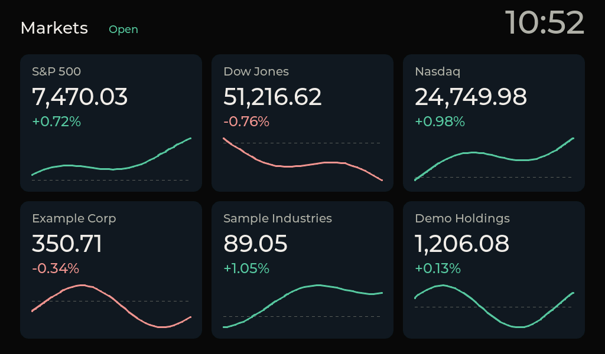
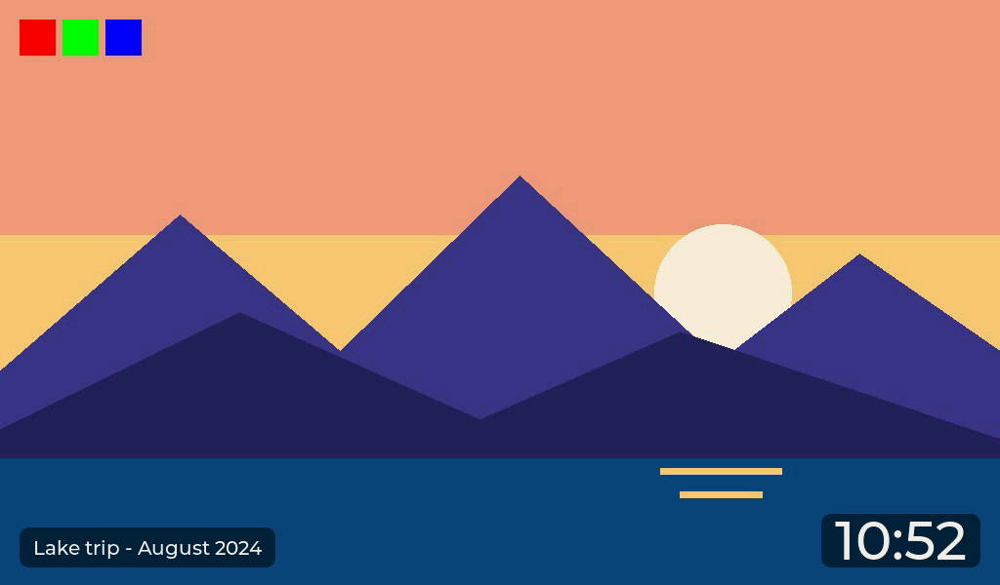
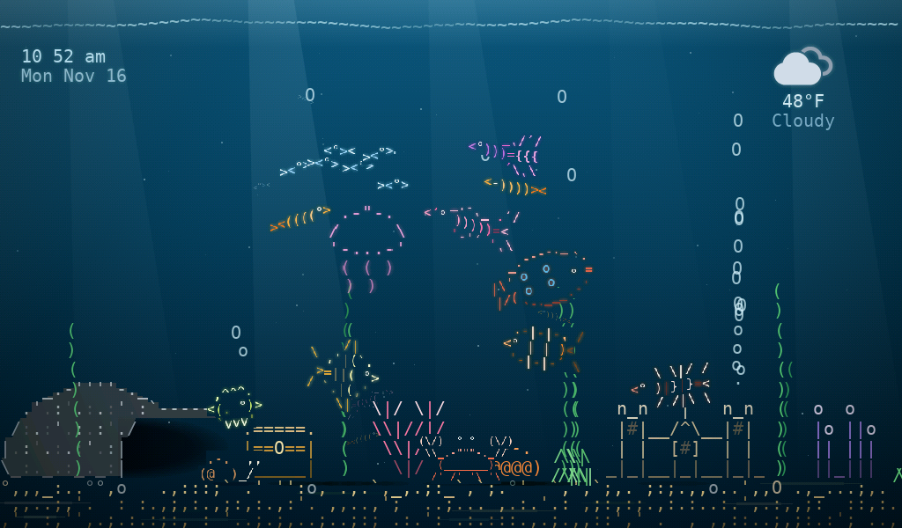
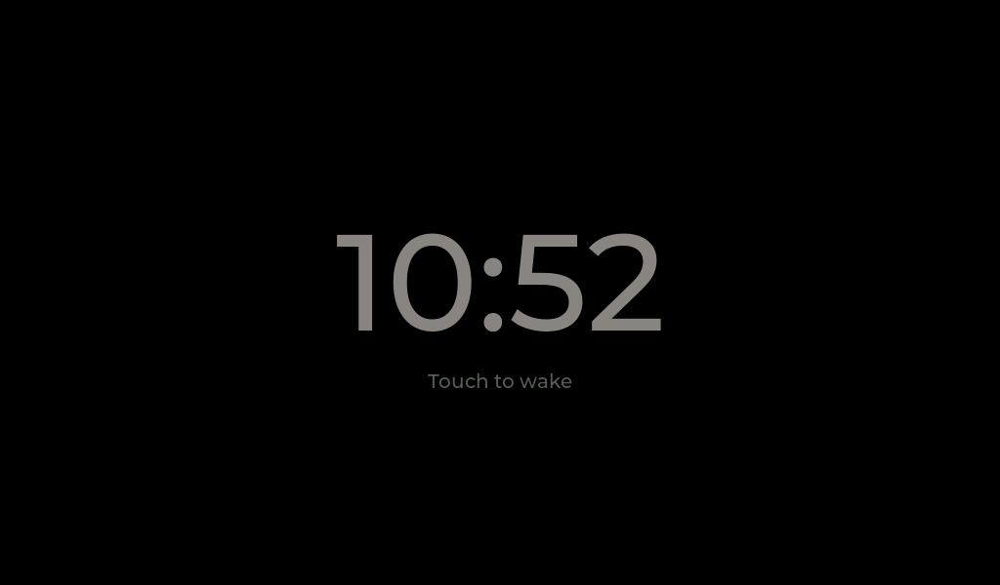

# Desk display firmware

The screen's user interface, written once in C++ with [LVGL](https://lvgl.io) and run in two
places: a desktop simulator for designing, and the ESP32-S3 board.

| Dashboard | Markets |
|---|---|
|  |  |

| Photo frame | Aquarium |
|---|---|
|  |  |

These are rendered by the simulator at the panel's real size, 1024×600, from the sample
data in `fixtures/`.

Overnight the screen switches to a dim clock:



## Simulator

It shows exactly what the device will draw, using the same code. Needs a C++ compiler,
libcurl, and SDL2 (`brew install sdl2` on macOS).

```bash
make deps
```

```bash
make run
```

`make run` opens a window fed by the server at `http://localhost:8080`. Drag left or right
with the mouse to change pages; the mouse acts as the finger.

| Command | What it does |
|---|---|
| `make run SERVER=http://host:8080` | Live data from another server |
| `make demo` | Canned data from `fixtures/`, no server needed |
| `make shots` | Render every page to `build/shots/*.png` (canned data) |
| `make shots LIVE=1` | The same, with live data |

## Layout

| Folder | Contents |
|---|---|
| `ui/` | Everything on screen. Shared by the simulator and the device. |
| `ui/fonts/` | Generated bitmap fonts (Montserrat). Regenerate with `tools/make_fonts.sh`. |
| `sim/` | Simulator: window, networking through libcurl, screenshots. |
| `tank/` | The aquarium and the 7B board driver, from Desk_Aquarium. |
| `fixtures/` | Sample server reply and photo for `make demo` and `make shots`. |
| `tools/make_fixtures.py` | Regenerates the sample data using the server's own code. |
| `lv_conf.h` | LVGL settings shared by both targets. |

`ui/platform.h` lists the three things each target must provide: an HTTP GET, a
millisecond clock, and a large-buffer allocator. The simulator's versions are in
`sim/main.cpp`.

## How the screens work

- **Dashboard** (`ui/dashboard.cpp`) polls `/api/dashboard` every 30 seconds. The clock is
  set from the server's reply, so the device needs no timezone settings of its own.
- **Markets** (`ui/markets.cpp`) draws a card per symbol from the same server reply.
- **Photo frame** (`ui/photo.cpp`) fetches `/api/photo/next` at the panel size every 30
  seconds while it is the visible page, and decodes the JPEG into one full-screen buffer.
- **Aquarium** (`ui/aquarium.cpp`) hosts the ASCII-art tank from
  [Desk_Aquarium](https://github.com/npceight/Desk_Aquarium), which lives in `tank/` (see
  [tank/README.md](tank/README.md)). The tank has its own drawing engine; on the board it
  takes over the panel while its page is showing. It follows the real sun for day and night
  and the real weather for its sky. Tap near the top to feed; tap the left or right edge for
  its buttons.
- **Weather icons** (`ui/icons.cpp`) are small shaded pictures stored in
  `ui/weather_icons.c`. `tools/make_weather_icons.py` draws and regenerates them.
- **The moon** (`ui/moon.cpp`) is one small texture of the moon's face, lit differently for
  each phase. `tools/make_moon.py` regenerates the texture.

## ESP32 target

`esp32/` builds the same `ui/` code for the Waveshare ESP32-S3-Touch-LCD-7B with
[PlatformIO](https://platformio.org). The panel, backlight and touch are driven by
`tank/board_7b.h`, which was written for this exact board; `esp32/src/main.cpp` adds Wi-Fi,
HTTP and the glue to the interface.

**Status: it compiles (about 2 MB), but has not been run on the board yet.**

```bash
cp esp32/src/secrets.example.h esp32/src/secrets.h   # then set Wi-Fi name, password, server address
```

```bash
cd esp32 && pio run -t upload && pio device monitor
```

Things to know for first power-up:

- **Use the board's UART port**, not the one labelled USB, and check its small UART
  selection switch if uploads fail with "No serial data received".
- **Screen checks.** `tank/README.md` points to the original project, whose README has a
  step-by-step checklist for a new board (backlight direction, colour order, flicker). The
  matching settings are at the bottom of `tank/settings.h`: `BACKLIGHT_INVERTED`,
  `SWAP_RED_BLUE`, `LCD_PCLK_HZ`, and `TOUCH_FLIP_X` / `TOUCH_FLIP_Y`.
- **Memory is the tight resource.** The panel's two screen buffers, the tank's backgrounds
  and the photo buffer use about 7 of the board's 8 MB. If the aquarium page stays blank,
  that is the first thing to suspect.
- **Brief pauses.** Network requests run on the same thread as the screen, so the display
  freezes for a moment while a photo downloads.
- **Server address.** `SERVER_URL` must be the server's address on your network. To the
  ESP32, `localhost` means the ESP32 itself.
