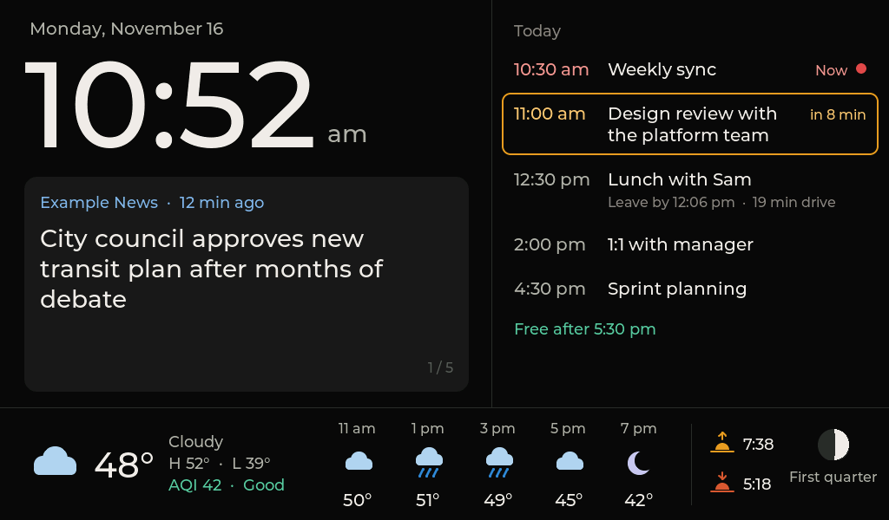

# Desk display firmware

The screen's user interface, written once in C++ with [LVGL](https://lvgl.io) and run in two
places: a desktop simulator for designing, and the ESP32-S3 board.

| Dashboard | Photo frame | Aquarium |
|---|---|---|
|  |  |  |

These are rendered by the simulator at the panel's real size, 1024×600, from the sample
data in `fixtures/`.

Overnight the screen switches to a dim clock:


## Simulator

It shows exactly what the device will draw, using the same code. Needs a C++ compiler,
libcurl, and SDL2 (`brew install sdl2` on macOS).

```bash
make deps
```

```bash
make run
```

`make run` opens a window fed by the server at `http://localhost:8080`. Drag left or right
with the mouse to change pages; the mouse acts as the finger.

| Command | What it does |
|---|---|
| `make run SERVER=http://host:8080` | Live data from another server |
| `make demo` | Canned data from `fixtures/`, no server needed |
| `make shots` | Render every page to `build/shots/*.png` (canned data) |
| `make shots LIVE=1` | The same, with live data |

## Layout

| Folder | Contents |
|---|---|
| `ui/` | Everything on screen. Shared by the simulator and the device. |
| `ui/fonts/` | Generated bitmap fonts (Montserrat). Regenerate with `tools/make_fonts.sh`. |
| `sim/` | Simulator: window, networking through libcurl, screenshots. |
| `fixtures/` | Sample server reply and photo for `make demo` and `make shots`. |
| `tools/make_fixtures.py` | Regenerates the sample data using the server's own code. |
| `lv_conf.h` | LVGL settings shared by both targets. |

`ui/platform.h` lists the three things each target must provide: an HTTP GET, a
millisecond clock, and a large-buffer allocator. The simulator's versions are in
`sim/main.cpp`.

## How the screens work

- **Dashboard** (`ui/dashboard.cpp`) polls `/api/dashboard` every 30 seconds. The clock is
  set from the server's reply, so the device needs no timezone settings of its own.
- **Photo frame** (`ui/photo.cpp`) fetches `/api/photo/next` at the panel size every 30
  seconds while it is the visible page, and decodes the JPEG into one full-screen buffer.
- **Aquarium** (`ui/aquarium.cpp`) paints the scenery once and moves small fish and bubble
  objects over it, so only the areas around them are redrawn.
- **Icons** (`ui/icons.cpp`) are drawn from circles, lines and arcs. There is no icon font.

## ESP32 target

`esp32/` builds the same `ui/` code for the Waveshare ESP32-S3-Touch-LCD-7B with
[PlatformIO](https://platformio.org). `esp32/src/main.cpp` holds everything specific to the
board: panel, touch, Wi-Fi and HTTP.

**Status: it compiles (about 1.6 MB), but has not been run on the board yet.**

```bash
cp esp32/src/secrets.example.h esp32/src/secrets.h   # then set Wi-Fi name, password, server address
```

```bash
cd esp32 && pio run -t upload && pio device monitor
```

Things to expect on first power-up, roughly in order of likelihood:

- **Panel settings.** The display library has no entry for the 7B, so `platformio.ini`
  selects its 1024×600 sibling, the 5B. If the picture is blank, shifted or flickering,
  the timing values are the first thing to compare against Waveshare's 7B example.
- **Picture drift while Wi-Fi is busy.** Set `USE_BOUNCE_BUFFER` to 1 in `main.cpp`.
- **Brief pauses.** Network requests run on the same thread as the screen, so the display
  freezes for a moment while a photo downloads.
- **Server address.** `SERVER_URL` must be the server's address on your network. To the
  ESP32, `localhost` means the ESP32 itself.
